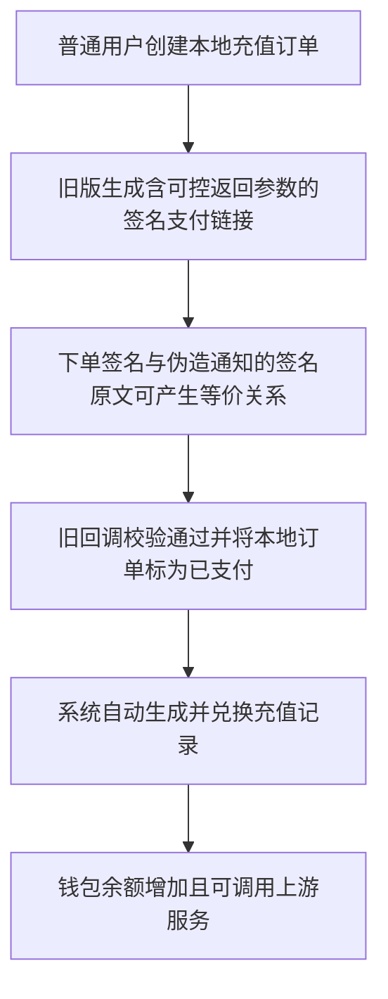

# CheapBuddy 批量注册与异常充值安全事件报告

| 项目 | 内容 |
| --- | --- |
| 事件编号 | CB-SEC-20261019 |
| 编制日期 | 2026-10-19 |
| 时间口径 | 北京时间，UTC+8；原始 JSON 中的 `Z` 时间为 UTC |
| 已观察事件窗口 | 2026-10-17 至 2026-10-19；不据此排除窗口外活动 |
| 修复验证基准 | 10 月 19 日 11:30—11:43 的生产检查，及随后浏览器观察 |
| 事件状态 | 已完成账户隔离、支付止血和补丁部署；财务对账、完整凭据排查及真人注册验收仍未闭环 |
| 文档用途 | 内部安全复盘、修复交接与恢复服务依据 |

本文汇总本次会话中实际完成的调查、代码修复、生产配置和验证。配置表表示最近一次已保存的验证快照，不代表持续监控结果。早期调查记录中的“ID 50 仍 active”“EasyPay 尚未暂停”等描述属于当时状态，已被后续处置取代。

## 1. 核心结论

**高置信度：本次异常充值符合旧版 Sub2API 的 EasyPay 下单签名复用、伪造支付成功回调漏洞。批量注册则由未验证邮箱、未开启人机验证，以及可被伪造的转发 IP 参与限流判断共同促成。**

已有证据可以独立解释攻击者如何获得充值额度，无须假设其先取得管理员 access token、上游 API Key 或 EasyPay 商户密钥。但现有检查不能证明这些凭据从未泄露，也不能代替完整的失陷排查。

| 用户关切 | 调查结论 | 证据边界 |
| --- | --- | --- |
| 为什么可以批量创建 `example.com` 用户？ | 当时开放注册，未验证邮箱、未启用 Turnstile；共享安全 IP 解析信任原始转发头，使按 IP 限流可被改变分桶 | 日志中的来源 IP 可能被伪造，不能用来归属攻击者 |
| 没有付费订单，为什么能给账户充值？ | 存在本地充值订单；伪造成功回调使其进入已支付和已履约状态，系统随后自动入账 | 本地 `COMPLETED` 不等于支付平台确认收款 |
| 是否管理员 token 或商户 key 泄露？ | 已知漏洞不需要这些凭据；查询窗口未发现管理员写操作审计 | 尚不能排除其他时间、其他入口的泄露或滥用 |
| 是否 Sub2API 有漏洞？ | 是，本次特征匹配官方已修复的 EasyPay 签名复用漏洞；生产旧部署缺少该补丁 | 本次移植指定补丁，未升级为完整的上游新版本 |
| 是否支付平台自身被攻破？ | 未取得支持这一结论的证据；已定位站点支付集成和履约信任链缺陷 | 商户实收仍需后台交易导出对账 |
| 是否已经彻底结束事件？ | 已阻断已确认的继续充值路径，并隔离已识别账户 | 实收对账、历史余额处理、完整凭据排查及真人验证仍待完成 |

官方 [Sub2API v0.2.14 发布说明](https://github.com/Wei-Shaw/sub2api/releases/tag/v0.2.14)确认了无需商户密钥即可将下单签名用于伪造成功回调的问题；本次对应的上游修复为 [d1aac6b](https://github.com/Wei-Shaw/sub2api/commit/d1aac6b98989b79d66c0f52bd18dc8c3142e7601)。

## 2. 调查范围、资产与方法

### 2.1 涉及资产

| 资产 | 用途 |
| --- | --- |
| Railway 项目 `cheapbuddy`、环境 `production`、服务 `sub2api` | 用户、鉴权、支付和余额履约 |
| `admin.cheapbuddy.cc` | 管理入口及本次主要验证入口 |
| `console.cheapbuddy.cc` | 用户控制台和注册页 |
| `cheapbuddy.cc` | 主站及 Cloudflare 邮件 Webhook 入口 |
| `api.cheapbuddy.cc` | API 中继入口 |
| Sub2API 原始 Railway 域名 | 验证是否可绕过外层站点防护 |
| Cloudflare Worker、Email Sending、Turnstile | 邮件投递、人机验证与现有转发能力 |
| Sub2API 使用的 `Postgres` 服务 | 订单、账户、审计与余额证据；未使用 NewAPI 的另一数据库 |

### 2.2 取证与判断方法

1. 关联账户、注册审计、订单、支付审计、充值码履约和调用记录，确定账户与订单范围。
2. 核对生产部署记录、本地对应修订及官方补丁，定位缺失修复。
3. 对 277 笔异常订单已有的真实支付链接进行**离线签名原文比较**；没有向生产发送伪造支付成功通知，也没有新增测试充值。
4. 数据库调查使用只读事务并回滚；生产处置写操作与取证结果分开记录。
5. 修复后使用不会成功开户或充值的负向请求、健康检查、邮件测试和鉴权检查验证防护。

新整理的报告不包含管理员密码、access token、JWT 签名密钥、商户密钥、上游 API Key、完整签名支付链接或可直接复用的攻击请求。账户以内部 ID 和域名统计标识，避免复制完整个人邮箱。

## 3. 已确认影响范围与金额口径

### 3.1 异常账户与充值

| 指标 | 已确认数值 | 解释 |
| --- | --- | --- |
| 当前未软删除的 `@example.com` 账户 | 220 个 | 均已禁用；该统计不含历史软删除账户 |
| 其中有同类异常充值的账户 | 155 个 | 不能将全部 220 个都计为有充值账户 |
| `example.com` 异常本地订单 | 275 笔 | 均曾进入 `COMPLETED` |
| `example.com` 异常入账额度 | 20,815.69230744 USD | 钱包账务额度，非已核定现金损失 |
| 上述订单本地标称支付金额 | 135,302 CNY | 本地记录，不代表商户实收 |
| 额外同类账户 | 用户 ID 50 | 不属于 `example.com`，已补充隔离 |
| ID 50 同类异常订单与入账 | 2 笔；315.38461538 USD | 单独关联后纳入事件范围 |
| 全部同类异常订单与账户 | **277 笔；156 个账户** | 275 + 2 笔，155 + 1 个账户 |
| 全部同类异常入账额度 | **21,131.07692282 USD** | 与真实支付收款分开核算 |
| 全部订单本地标称支付金额 | **137,352 CNY** | 尚待商户后台实收对账 |

其中，`example.com` 的 275 笔异常订单均缺少支付平台交易号，支付链接均含异常成功状态参数；273 笔在创建后不到 2 秒即完成。这些特征与离线签名比较、支付审计和自动履约记录共同构成判断依据，不能单凭某一条 HTTP 200 回调日志判定交易真伪。

### 3.2 已使用额度与成本

| 指标 | 调查快照 | 口径说明 |
| --- | --- | --- |
| `example.com` 账户成功调用 | 17,723 次 | 120 个目标用户存在使用记录 |
| 对应客户账务扣费 | 721.9872745479 USD | 客户钱包扣费口径 |
| 对应 `account_stats_cost` | 517.5634525289 USD | 系统成本统计口径，仍需供应商账单核验 |
| `example.com` 账户余额合计 | 20,313.70502892 USD | 调查时点存量，尚未按异常订单回退 |
| ID 50 调用与账务扣费 | 347 次；9.1218979089 USD | 独立调查快照，未混入上述域名统计 |

**异常入账额度、客户扣费、系统成本和最终现金损失是四个不同指标。** 不能将 21,131.08 USD 或本地标称 137,352 CNY 直接写为已确认损失。最终损失应结合商户实收、上游供应商结算、真实客户权益及余额处置结果核定。

早期 overview 统计曾包含 12 个历史软删除账户，最终目标规模以 final-validation 的 220 个当前账户为准。

## 4. 事件与处置时间线

下表统一使用北京时间；未记录精确完成时刻的步骤使用阶段描述。

| 时间 | 事件或处置 |
| --- | --- |
| 10 月 6 日 11:19:05 | 旧生产部署完成，部署标注 `USD ledger b485e6a`，对应定制分支基于 0.2.13 |
| 10 月 7 日 | 官方发布 v0.2.14，包含 EasyPay 签名复用安全修复 |
| 10 月 13 日 | 仓库升级研究文档已记录缺失的安全补丁；本次调查时旧生产仍未包含修复 |
| 10 月 17 日 09:58:44—11:23:09 | 220 个当前 `example.com` 账户集中创建 |
| 10 月 17 日 10:04:27 至 10 月 18 日 02:17:58 | 已确认的 `example.com` 异常订单窗口 |
| 10 月 17 日 11:38:45 至 10 月 19 日 04:55:21 | 目标账户已观察到的调用窗口，早于本次禁用 |
| 10 月 19 日初始处置阶段 | 禁用 220 个 `example.com` 账户，清理相关鉴权缓存并验证拒绝访问 |
| 10 月 19 日 10:55 左右 | 完成 277/277 笔离线签名原文等价核验；商户只读抽查未取得可用交易状态 |
| 10 月 19 日 11:01 | 处置记录确认 EasyPay 实例关闭、ID 50 隔离、注册临时关闭、邮箱验证开启、旧转发头信任关闭 |
| 随后的支付暂停阶段 | 加入临时数据库订单保护，保留历史订单与余额证据 |
| 10 月 19 日 11:11:08 | Cloudflare 邮件 Webhook 测试成功，随后在邮箱中确认收信 |
| 10 月 19 日 11:24:57 | 本地修复提交 `c6c941a` 生成 |
| 10 月 19 日 11:25:03 | 提交 Railway 安全部署 |
| 10 月 19 日约 11:29 | 安全部署成功，随后验证服务端支付阻断、可信代理和注册限流 |
| 10 月 19 日 11:30:14 | 已部署应用的管理端测试邮件确认送达收件箱 |
| 10 月 19 日 11:31:39 | 验证通过后恢复公开注册，保持强制邮箱验证 |
| 10 月 19 日 11:32:23 | ID 50 的 3 个 API Key 在直接和中继入口的 6 次检查均为 401 |
| 10 月 19 日 11:43:06 | Turnstile 启用验证记录完成，12 次缺失／伪造凭证检查全部拒绝 |
| 随后浏览器观察 | 注册页面加载生产 SDK 并创建控件 DOM；自动化环境出现 `300030`，尚未完成正常用户正向验收 |

## 5. 根因一：批量注册防护不足

### 5.1 事发时配置

| 配置项 | 当时值 | 造成的缺口 |
| --- | --- | --- |
| `registration_enabled` | `true` | 公共注册 API 可用 |
| `email_verify_enabled` | `false` | 无须证明邮箱归属即可开户 |
| `turnstile_enabled` | `false` | 注册和验证码发送缺少此类人机验证 |
| `registration_email_suffix_whitelist` | 空列表 | 未限制可注册邮箱后缀 |
| `registration_email_domain_quota_enabled` | `false` | 未限制单邮箱域名注册数量 |
| `api_key_acl_trust_forwarded_ip` | `true` | 兼容开关影响共享的安全客户端 IP 解析，不只影响 API Key ACL |

注册路由原本有按 IP 限流。但当安全 IP 解析接受客户端可伪造的 `X-Forwarded-For`、`CF-Connecting-IP` 等原始转发头时，调用者可以改变限流键，降低固定 IP 桶的作用。

注册审计中出现 `192.0.2.*`、`198.51.100.*`、`203.0.113.*` 等文档示例网段，以及 `198.18.*` 等异常来源值。这与切换伪造来源分桶相吻合；这些日志值不能当作攻击者真实出口地址。查询窗口累计注册成功 242 次、限流 113 次，包含非目标用户，不等于目标账户数量。

### 5.2 已落实修复

- 恢复公开注册前，先强制邮箱验证码验证；缺失或错误验证码不能创建账户。
- 将注册开关与邮箱验证开关放在一次经校验的策略读取中。读取失败或邮箱验证配置缺失、非法时拒绝请求，避免异常时默认放行。
- 开启 Turnstile 服务端验证，并覆盖发送验证码和密码登录等相关入口。
- 使用 Railway 专用客户端 IP 模式，只接受明确可信代理提供的入口净化字段；不再无条件信任客户端原始转发头。
- 保留注册、发送验证码两个接口各自每个可信客户端 IP 每分钟 5 次的限流；Redis 异常时拒绝受保护请求。

这些措施提高批量开户成本，并修复已确认的分桶绕过路径；不保证能完全阻止拥有多个有效邮箱、多个出口 IP 或真人打码资源的攻击者。邮箱后缀白名单、域名配额、邀请码和审批制没有作为本次新增措施启用。

## 6. 根因二：EasyPay 签名复用与自动履约信任链

### 6.1 为什么“没有真实付款”也会出现充值记录

本次已经发现本地充值订单，问题出在系统把可伪造的通知当作支付成功依据。逻辑链条如下：



因此，“有充值码记录”“本地订单已完成”“回调返回 200”都不能单独证明商户已收到真实付款。这里的充值码记录来自系统支付履约，不构成管理员手工发码或直接修改余额的证据。

### 6.2 共同作用的代码缺陷

| 环节 | 旧行为 | 安全影响 |
| --- | --- | --- |
| 返回 URL 处理 | 校验域名和路径，但保留客户端提供的查询参数 | 不可信输入进入后续签名结构 |
| 弹出式支付下单 | 向用户生成签名支付链接，不要求已在商户平台形成真实已支付交易 | 攻击者可获得合法下单签名 |
| 签名原文构造 | 参数排序后直接拼接未经转义的值 | 嵌套参数可能改变原文的结构解释 |
| 回调通知校验 | 缺少通知参数集合限制；支付平台交易号可为空 | 下单签名可被用到不同语义的通知场景 |
| 支付履约 | 接受回调后直接更新订单并入账 | 此路径没有先向商户平台核实实际支付状态 |

这是签名数据结构和使用场景的歧义，不是已证明的密码算法破解。单独更换商户密钥无法消除该歧义：未修复服务仍可向普通用户生成新的签名链接。

### 6.3 支持判断的证据与限制

- 277/277 笔订单已有支付链接的下单签名原文，与对应伪造通知的签名原文离线比较一致，涉及 156 个账户。
- `example.com` 的 275 笔订单均缺少平台交易号并带异常返回参数，273 笔极快完成。
- 支付审计串联了创建、标记支付、充值履约；历史窗口另保存 28 条回调访问记录。
- 历史访问日志没有保留这些回调的完整请求体，因此不是逐条抓包还原所有攻击请求。
- 对 5 笔订单调用商户只读查询，得到 HTTP 200 但响应体为空；未把空响应解释为“未支付”。

由此可高置信度定位异常入账路径；每一笔订单是否存在任何真实实收，仍以商户后台交易核验为准。

## 7. 已实施的账户隔离与支付止血

### 7.1 账户和缓存

| 措施 | 完成状态与证据 |
| --- | --- |
| 禁用 220 个当前 `example.com` 用户 | 最终只读复核 `disabled=220`、非禁用目标为 0 |
| 清理目标用户鉴权缓存 | 包含 124 个 API Key；初次直接／中继访问验证共 240 次，全部拒绝 |
| 隔离 ID 50 | 账户已禁用，其 3 个 Key 的缓存已清理 |
| 验证 ID 50 访问受阻 | 直接入口与中继入口共 6 次检查，全部 HTTP 401 |
| 保留证据 | 未删除目标账户、历史订单或充值记录，未直接清零历史余额 |

“清理缓存并通过账户状态拒绝访问”不等于对所有历史 API Key 执行了密钥值轮换；本次未将未执行的轮换列为已完成事项。

### 7.2 EasyPay 的三层暂停

1. **支付实例层：** EasyPay 实例 ID 1 设置 `enabled=false`；Stripe 实例 ID 2 保持启用。
2. **服务端业务层：** `EASYPAY_MAINTENANCE_ENABLED=true`。阻断 EasyPay 创建订单、GET/POST 回调、订单主动查询／对账触发履约、重试及实际入账等路径。退款在获取 EasyPay provider 时也会遇到维护保护，但检查位置不足以保证退款状态和余额始终不变：代码可能先更新状态／扣减余额，空平台交易号分支会跳过获取 provider。因此不能将退款链路记为已完成全面暂停验收，见第 13 节与 PAY-09。
3. **数据库层：** 临时函数及触发器 `public.cheapbuddy_pause_easypay_20261019` 拒绝 EasyPay 新订单插入，以及进入 `PAID`、`RECHARGING`、`COMPLETED` 的状态变更；使用 SQLSTATE `55000`，已用回滚探针验证。

仅关闭实例不够：历史订单保存了供应商快照，仍可能解析已关闭的实例并接收回调。新增维护开关独立于实例状态执行。对无法明确排除 EasyPay 的非 Stripe 历史订单，暂停期间采取拒绝履约策略；这可能同时冻结部分绑定信息不完整的历史订单，恢复前须单独确认。

最终只读审计快照中，全库 EasyPay 相关本地订单共 363 笔，其中 302 笔 `COMPLETED`，`PAID=0`、`RECHARGING=0`；11:01 止血后新增 EasyPay 订单和新增完成数均为 0。**363/302 是全部相关 EasyPay 订单口径，277 是本次识别的异常订单子集，二者不可混用。**

## 8. 已部署的代码修复与版本标识

### 8.1 官方补丁移植

移植 [上游 d1aac6b](https://github.com/Wei-Shaw/sub2api/commit/d1aac6b98989b79d66c0f52bd18dc8c3142e7601) 的关键防护：清除客户端返回 URL 中不可信查询参数，并拒绝非标准回调通知参数，同时补充安全回归覆盖。保留 CheapBuddy 现有 USD 钱包账务与其他定制。

这次交付是安全补丁回移，不能据此宣称已完成整个 Sub2API 最新版本升级，或已覆盖上游所有其他安全变化。

### 8.2 本次额外加固

- 增加独立 EasyPay 暂停检查，覆盖历史供应商快照、延迟初始化和不明确历史订单的处理。
- 将注册防护改为一次经校验的策略快照，避免人机验证和邮箱验证读取不一致或异常放行。
- 增加 Railway 客户端 IP 模式和相关代理回归测试。
- 增加 Cloudflare 验证邮件通道及管理端测试邮件支持；缺失配置、投递失败时不静默回退。
- 收紧邮件错误输出，避免将潜在邮件正文或凭据带入错误信息。

安全复核曾发现不明确历史订单维护判断、邮箱验证配置异常时放行两类问题，均已修复并经过第二轮复核。

### 8.3 提交、部署与主要文件

| 项目 | 标识 |
| --- | --- |
| 修复提交 | `c6c941ad3b8a906e9fcc620d120a5011c930847d`，简称 `c6c941a` |
| 独立修复分支 | `codex/incident-payment-registration-20261019` |
| 主源码目录 | `sub2api-coworkany`，已快进到同一修复提交 |
| Railway 修复部署 | `ebd2caa2-c3a4-48fc-a685-5bd2d62b84a9`，状态 `SUCCESS` |
| 变更规模 | 30 个源代码／测试文件，1612 行新增、30 行删除；多数新增为测试 |
| Turnstile 启用方式 | 通过既有后台配置热更新，未另改源代码或重新部署 |

部署记录的 `commitHash` 字段为空；修订关联依据是 CLI 部署目录、构建过程、部署标注及线上验证，不声称已对运行镜像做逐文件哈希证明。旧部署的 `b485e6a` 关联同样依据部署标注与对应本地修订。

| 修复领域 | 主要源码文件，均相对 `sub2api-coworkany/` |
| --- | --- |
| 签名和返回 URL | `backend/internal/payment/provider/easypay.go`；`backend/internal/service/payment_resume_service.go` |
| 支付维护保护 | `backend/internal/service/payment_easypay_maintenance.go`；`payment_order.go`；`payment_order_lifecycle.go`；`payment_resume_lookup.go`；`payment_fulfillment.go`；`payment_webhook_provider.go`；`backend/internal/handler/payment_webhook_handler.go` |
| 注册验证 | `backend/internal/service/auth_registration_policy.go`；`auth_service.go`；`backend/internal/handler/auth_handler.go` |
| 可信代理 | `backend/internal/config/config.go`；`backend/internal/server/http.go`；`backend/internal/server/middleware/session_binding.go` |
| 邮件投递 | `backend/internal/service/email_service.go`；`cloudflare_email_webhook.go`；`backend/internal/handler/admin/setting_handler_email.go` |

实现复用了既有邮件 Worker 和设置接口，没有引入新依赖；注册策略集中为一次读取，避免增加多套开关判断逻辑。对无关工作区改动和已确认的旧测试失败未作顺带修改。

## 9. 线上安全配置与可信代理边界

| 设置或状态 | 最近验证结果 | 含义 |
| --- | --- | --- |
| `registration_enabled` | `true` | 仍允许公开注册，须完成验证 |
| `email_verify_enabled` | `true` | 强制邮箱验证码 |
| `turnstile_enabled` | `true` | 启用 Cloudflare Turnstile |
| `turnstile_secret_key_configured` | `true` | 服务端密钥已保存；公共配置不返回密钥 |
| `api_key_acl_trust_forwarded_ip` | `false` | 关闭旧版直接信任转发头的兼容行为 |
| `SERVER_CLIENT_IP_MODE` | `railway` | 以 Railway 可信入口模型解析客户端 IP |
| `SERVER_TRUSTED_PROXIES` | `100.64.0.0/10` | 当前部署明确配置的 Railway 代理对端范围 |
| `EASYPAY_MAINTENANCE_ENABLED` | `true` | 继续暂停 EasyPay 服务端业务 |
| `CLOUDFLARE_AUTH_EMAIL_ENABLED` | `true` | 验证码和管理测试邮件使用 Cloudflare 通道 |
| EasyPay 实例 1／Stripe 实例 2 | 关闭／启用 | 不将 EasyPay 止血扩大为全站支付关闭 |
| `session_binding_enabled` | `false` | 保持既有状态；本次未宣称启用会话 IP 绑定 |

当前模式只从符合可信代理范围的 Railway 对端接受其净化后的 `X-Real-IP`，不将任意 `X-Forwarded-For`、`CF-Connecting-IP` 直接用于安全判断。相关接口均使用可信客户端 IP 限流。

该配置是当前 Railway 环境的部署边界，不是可直接复制到任意主机的通用信任名单。经过 Cloudflare 代理时，部分访客仍可能共用 Cloudflare 边缘 IP 分桶；在源站来源尚未获得独立证明前，没有为追求更细粒度限流而恢复信任原始 Cloudflare 头。

## 10. 邮箱验证与 Cloudflare 发信

### 10.1 已完成配置

- 在 Cloudflare **Email Sending** 为 `cheapbuddy.cc` 启用发送能力，控制台显示发送启用、DNS 已配置。
- 加入服务要求的退信 MX、SPF、DKIM 和 DMARC 记录；当前 DMARC 策略为 `p=reject`。
- 使用 `no-reply@cheapbuddy.cc` 发信，通过已有 Worker 的 `NOTICE_EMAIL` 绑定投递。
- Sub2API 复用现有 HMAC 签名 Webhook；`CLOUDFLARE_AUTH_EMAIL_ENABLED=true` 将注册验证码和管理员测试消息接入此通道。
- 服务端在排队前检查发送配置；异步响应表示邮件已排队，不把“已排队”写成“收件人已收到”。

### 10.2 已验证与适用范围

11:11 的 Worker 测试邮件已在站点所有者邮箱的收件箱中找到，SPF、DKIM、DMARC 均通过。11:30 的新部署管理端测试邮件也确认进入收件箱，证明部署后的应用可以调用相同邮件传输通道。

未为了测试创建新账户，也未完成一条真人注册验证码领取和最终开户链路；管理测试邮件送达与完整注册成功是不同验收项。

**入站 Email Routing 与出站 Email Sending 是不同功能。** 本次完成的是注册验证所需的出站发信接入，没有配置新的通配收信、邮箱账户托管或入站转发。既有余额不足通知使用相同 Worker；密码重置等其他邮件事件仍沿用原 SMTP 行为，本次未将其全部迁移或逐项验收。

既有 HMAC Worker 的时间戳、签名及事件去重机制继续使用。Webhook 密钥、Turnstile 服务端密钥和 SMTP 口令均未写入本文。后续运维配置可参阅 [Cloudflare 邮件接入说明](cloudflare-email-webhook.md)。

## 11. Turnstile 人机验证

### 11.1 实际启用状态

| 项目 | 配置 |
| --- | --- |
| 小组件名称 | `CheapBuddy Auth` |
| 模式 | 托管模式，由 Cloudflare 根据风险决定检查方式 |
| 授权主机名 | `cheapbuddy.cc`，包含其子域名 |
| Pre-clearance | 关闭，不额外授予跳过其他安全规则的预清除能力 |
| 服务端 | 已保存生产密钥并启用验证 |
| 公共配置 | 主站、控制台、管理域名、原始源站均返回启用状态和相同公共 site key，不暴露 secret |

Cloudflare 要求后端调用 Siteverify 验证令牌；仅展示前端小组件不足以保护接口。令牌有有效期且只能使用一次，不能在多个操作中随意复用。[Cloudflare 服务端验证说明](https://developers.cloudflare.com/turnstile/get-started/server-side-validation/)

### 11.2 当前覆盖与边界

- 普通密码登录、发送邮箱验证码、忘记密码和常规注册流程使用现有服务端人机验证集成。
- 邮箱验证流程先在人机验证后发码，最终注册携带邮箱验证码时允许避免重复消费同一 Turnstile 令牌；服务端仍验证邮箱验证码，任意字符串不能代替有效验证码。
- 相关代码中的部分 OAuth 自动开户、完成注册及 pending bind-login 路径并非统一执行 Turnstile；当前已检查的 GitHub、Google、LinuxDo、OIDC、微信等相关开关均关闭。未来启用前必须另行补齐或审查这些路径。
- 本次未把 Passkey 登录、所有 OAuth 入口或全部 API 请求都改为强制 Turnstile。

### 11.3 验证结果和未完成事项

注册、发送验证码、密码登录三个接口，分别对缺失令牌与伪造令牌进行测试；在管理域名与原始 Railway 域名合计 12 次，全部 HTTP 400 `TURNSTILE_VERIFICATION_FAILED`。忘记密码缺少凭证也被拒绝。

真实注册页面已加载生产 Turnstile SDK 并创建控件 DOM，但自动化浏览器出现 `300030`，没有取得有效通过令牌。官方将 `300*` 归为与机器人检测有关的通用挑战失败；不能据此证明普通用户一定失败，也不能据此宣称正常用户流程已经通过。[Cloudflare 错误码说明](https://developers.cloudflare.com/turnstile/troubleshooting/client-side-errors/error-codes/)

因此仍需在正常浏览器中完成“人机验证通过 → 验证邮件送达 → 验证码通过 → 成功开户”的正向验收。生产保护保持开启，未为自动化测试关闭或绕过验证。


## 12. 验证矩阵与已知测试限制

| 验证项 | 实际结果 | 结论边界 |
| --- | --- | --- |
| 277 笔订单签名原文离线比较 | 277/277 等价 | 支持漏洞路径定位；未向生产发伪造回调 |
| `example.com` 账户隔离 | 220 个禁用，非禁用目标 0 | 当前已识别目标范围 |
| ID 50 的 3 个 Key | 直接／中继 6 次均 401 | 验证当前鉴权拒绝，非所有凭据已轮换 |
| 生产与原始源站健康 | HTTP 200 | 服务可用，不等于完整业务无问题 |
| EasyPay GET/POST 回调 | 两个入口均 503 | 包含原始源站，不能仅绕过前端调用 |
| 已鉴权 EasyPay 下单 | 503 | 确认服务端阻断创建 |
| 未签名 Stripe 回调 | 400；实例仍启用 | 未做真实付费 Stripe 交易验收 |
| 伪造转发头的注册请求 | 同一真实来源桶，第 6 次 429 | 前 5 次在临时关闭注册时为 403；未创建账户 |
| 强制邮箱验证 | 恢复注册时缺码为 `EMAIL_VERIFY_REQUIRED`，错码为 `INVALID_VERIFY_CODE` | Turnstile 开启后，缺少人机凭证可能更早被拒绝 |
| Turnstile 负向检查 | 12/12 拒绝，另有忘记密码检查 | 未完成正常用户有效令牌正向验证 |
| 邮件投递 | Worker 与已部署管理测试邮件均确认收件箱送达 | 不等于所有邮件类型均已迁移或验收 |
| Go 构建、vet、gofmt、空白检查 | 通过 | 针对本次代码修复及已记录范围 |
| 六个非 service Go 包 | provider、handler、admin handler、server、middleware、config 通过 | 不是全仓库每个测试均通过 |
| 相关 service 回归 | 支付、USD 账务、注册、邮箱等通过 | 含本次新增安全回归 |
| service 全量运行 | 15,495 个测试／子测试通过，4 跳过，2 失败 | 两项失败已在未修改父提交复现 |
| Turnstile 相关前端测试 | 33 项通过 | 使用 mock／进程内测试，不替代真实挑战验收 |

两项已在父提交 `201a060` 复现的失败：

1. `TestOpenAIWSHTTPBridgeAcceptsFirstFrameAboveLegacy16MiB`：Windows 本机回环大帧写入在约 10 秒处中止。
2. `TestOllamaProbeCallback_StaleLongDoesNotOverrideNewShort`：过期探测回调的 CAS 断言不符。

本次未把这两项失败报告为已修复，也不宣称所有测试全绿。构建过程中的前端类型检查和生产构建已通过；因 EasyPay 被刻意暂停，未进行真实支付到账的生产正向测试。

## 13. 剩余事项与风险登记

| 优先级 | 事项 | 当前状态与完成标准 |
| --- | --- | --- |
| 高 | 商户实收对账 | 待完成。导出 277 笔关联交易，核对商户号、订单号、平台交易号、金额、币种和支付时间；空响应不作为未支付证据 |
| 高 | 历史异常余额和订单处置 | 待完成。区分真实实收、未实收、重复或不明确订单；形成可审计处理方案，保留原账及调整记录 |
| 高 | 正常用户完整注册验收 | 待完成。普通浏览器通过生产 Turnstile、收到验证码并完成注册；自动化环境 `300030` 尚不能替代该结果 |
| 高 | 管理员及关键凭据异常使用排查 | 未完成全面排查。扩展审计窗口、核对登录与访问来源、检查凭据暴露位置；本次没有自动轮换上游 Key、JWT 签名密钥和商户密钥 |
| 高 | EasyPay 退款维护检查前置 | 文档用例复核中发现代码边界：`ExecuteRefund` 可先更新退款状态／扣减余额，`gwRefund` 的空平台交易号分支不获取 provider，不能据此保证维护期开关阻断所有退款副作用。线上退款开关与可达条件未重新验证，未对生产执行退款；须补充前置保护并按 PAY-09 隔离复测，本轮仅记录风险 |
| 中 | OAuth 新入口防护 | 当前相关入口关闭。启用前检查所有自动注册、完成注册、账号绑定及密码验证路径 |
| 中 | 真实访客 IP 归属与边缘桶共享 | 当前选择可信 Railway 入口；Cloudflare 访客可能共用边缘桶。优化前先证明源站流量来源，不能直接重新信任原始头 |
| 中 | 安全补丁发布闭环 | 仓库曾记录补丁但生产未升级；需明确漏洞跟踪、修复部署和线上验证的责任与验收记录 |
| 中 | 两项既有测试失败 | 已复现基线，未在本次修复；另行处理 Windows 大帧与 Ollama 回调问题 |
| 低 | 临时加密管理会话文件清理 | 自动审批拒绝删除，返回 `blocked by policy`，未提供更具体原因；明文 Turnstile 密钥和请求文件已删除，剩余文件受用户 ACL 和 Windows DPAPI 保护，未声称已清理 |

Turnstile 或邮箱验证失败时不应直接关闭验证来恢复访问。应先定位具体浏览器、网络、域名授权、配置、投递或服务端问题；紧急情况下可维持注册关闭而保留已登录用户的正常服务。

## 14. EasyPay 恢复条件与操作交接

**目前 EasyPay 保持暂停。本文记录恢复要求，不代表已经执行恢复或已取得恢复付款的授权。**

恢复前应满足：

1. 277 笔异常订单及其他可疑待支付／已支付历史订单已审核，商户实收对账和余额处理方案有记录。
2. 目标账户保持隔离；重新启用账户必须有逐项审查依据，不能随支付恢复批量解除。
3. 部署确认仍包含 `c6c941a` 对应防护；后续升级不能覆盖 USD 账务和安全补丁。
4. 受控环境完成合法回调接受、非标准通知拒绝、签名复用拒绝、金额和币种匹配、订单绑定、幂等、重试及主动对账测试；补齐 PAY-09 所列退款维护前置保护并复测。
5. 维护者明确批准恢复，并准备监测和可立即重新暂停的操作路径。

执行时保持服务端维护保护，先核对历史订单状态与供应商绑定，再协调数据库触发器、实例开关和业务维护开关，避免某一层提前放行历史可疑订单。三者必须作为一组恢复变更管理，不能只删除数据库保护。

经授权进行受控小额真实交易并核对一次入账、商户实收和完整审计。若出现无平台交易号却完成、异常快速完成、重复入账或商户记录不符，立即重新暂停；应恢复到包含补丁的受保护版本，不能回滚到存在漏洞的旧镜像。

注册和支付恢复相互独立：注册已在邮箱验证、可信 IP 限流和 Turnstile 保护下开放；这不意味着 EasyPay 已恢复。

## 15. 后续防复发措施，尚未作为本次完成项

以下是后续建设方向，不表示已经部署告警、自动化任务或新的第三方服务：

- 对支付完成异常速度、平台交易号缺失、同额密集订单、同账户密集回调，以及商户实收与本地入账差异建立监测与人工复核。
- 对验证码发送量、同域名开户量、限流命中、人机验证失败比例和新用户立即大额充值建立异常观察。
- 为紧急支付暂停、关闭注册、隔离用户和缓存失效形成固定值班手册，保留执行人与验证时间。
- 在发布验收中核对实际生产部署，而不是仅确认仓库已合并补丁；记录运行版本与构建产物的可追溯关系。
- 若业务目标要求严格限制公开开户，再单独确定邀请码、审批、邮箱后缀或域名配额政策；不能把邮箱验证码当作一人一号证明。

## 16. 证据索引与复核入口

以下原始材料位于本地 `.omx/logs/`，部分不会随 Git 分发。本文需要与证据一起归档时，应保留文件内容与原始时间口径。早期阶段记录保留原状，不因后续修复而覆盖历史事实。

| 内容 | 证据文件 |
| --- | --- |
| 原始调查完整说明 | [incident-example-com-investigation-20261019.md](../.omx/logs/incident-example-com-investigation-20261019.md) |
| 处置与部署汇总 | [incident-remediation-20261019.md](../.omx/logs/incident-remediation-20261019.md) |
| 最终目标范围、异常订单和 ID 50 | [incident-example-com-final-validation.result.txt](../.omx/logs/incident-example-com-final-validation.result.txt) |
| 277 笔离线签名等价结果 | [incident-example-com-offline-signature-check.json](../.omx/logs/incident-example-com-offline-signature-check.json) |
| 商户只读抽查 | [incident-example-com-provider-reconciliation.json](../.omx/logs/incident-example-com-provider-reconciliation.json) |
| 旧部署证据 | [incident-example-com-deployment.json](../.omx/logs/incident-example-com-deployment.json) |
| 新部署证据 | [incident-patched-deployment-20261019.json](../.omx/logs/incident-patched-deployment-20261019.json) |
| 支付暂停、健康和伪造头检查 | [incident-patched-production-verification-20261019.json](../.omx/logs/incident-patched-production-verification-20261019.json) |
| 恢复强制邮箱验证注册 | [incident-registration-restoration-20261019.json](../.omx/logs/incident-registration-restoration-20261019.json) |
| 处置后数据库只读审计 | [incident-final-production-audit-20261019.result.txt](../.omx/logs/incident-final-production-audit-20261019.result.txt) |
| ID 50 最终 Key 隔离检查 | [incident-final-key-isolation-20261019.json](../.omx/logs/incident-final-key-isolation-20261019.json) |
| Cloudflare 邮件启用截图 | [incident-cloudflare-email-enabled-20261019.png](../.omx/logs/incident-cloudflare-email-enabled-20261019.png) |
| 邮件认证与收件箱证明 | [incident-cloudflare-inbox-verification-20261019.json](../.omx/logs/incident-cloudflare-inbox-verification-20261019.json)；[incident-cloudflare-admin-mail-verification-20261019.json](../.omx/logs/incident-cloudflare-admin-mail-verification-20261019.json) |
| Turnstile 配置、负向检查与验证限制 | [turnstile-enablement-20261019.json](../.omx/logs/turnstile-enablement-20261019.json) |
| Turnstile 控制台截图 | [turnstile-cloudflare-enabled-20261019.png](../.omx/logs/turnstile-cloudflare-enabled-20261019.png) |
| 本次相关 service 测试 | [incident-service-targeted-unit-20261019.txt](../.omx/logs/incident-service-targeted-unit-20261019.txt) |
| 六个非 service 包测试 | [incident-nonservice-unit-final-20261019.txt](../.omx/logs/incident-nonservice-unit-final-20261019.txt) |
| 全量 service 逐项结果 | [incident-service-unit-final-20261019.jsonl](../.omx/logs/incident-service-unit-final-20261019.jsonl) |
| 基线与修复版失败复现 | `incident-websocket-test-{baseline,isolated}-20261019.txt`；`incident-ollama-test-{baseline,isolated}-20261019.txt` |
| 邮件运维配置 | [cloudflare-email-webhook.md](cloudflare-email-webhook.md) |
| 先前升级风险记录 | [sub2api-upgrade-research-2026-10-13.md](sub2api-upgrade-research-2026-10-13.md) |

取证材料和运行配置均为本次已授权范围内获取或更改。本文新增的是复盘与交接记录，不执行支付恢复、账户解封、余额回退、密钥轮换或任何新的生产变更。

## 17. 安全回归与验收测试用例

本节共 **49 个逻辑用例**，同一用例中的接口、域名或故障变体需要分别执行和记录。测试目标包括拒绝危险输入、保持合法流程可用，以及确认失败请求没有创建账户、改变订单或增加余额。用例清单是后续可重复执行的验收规范，**新增到文档不表示本次重新执行了这些测试**；历史结果沿用第 12、16 节证据，未完成项目明确列为待验收。

### 17.1 测试环境、数据和结果口径

| 标记 | 环境与限制 |
| --- | --- |
| L：本地自动化 | 使用仓库既有 Go／Vitest 测试、内存桩、临时 HTTP 服务和测试凭据；不连接真实商户、不使用生产数据库或生产密钥 |
| S：隔离测试环境 | 运行同一补丁版本，使用独立数据库、Redis、Worker 和支付沙箱；数据库写入、并发、故障注入及维护开关切换仅在这里进行 |
| P：生产有限检查 | 只读配置、只读审计，或严格按既有止血条件进行的低频负向检查；不得向生产提交伪造成功回调、重试历史履约、直接写订单或切换维护开关 |
| H：正常浏览器人工验收 | 使用正常浏览器、维护者控制且未注册的邮箱；完整开户属于新增业务写入，需要安排验收账户。真实付费交易仅在第 14 节恢复条件满足并获批准后执行 |

执行前准备：

1. 记录目标环境、域名、时间、代码提交／部署 ID 和开关快照。生产基准应仍为邮箱验证、人机验证开启，EasyPay 维护开启、实例 1 关闭、数据库保护存在；若与第 9 节不符，先记录差异并停止依赖该配置的生产探测。
2. S 环境准备普通用户 A、普通用户 B、禁用用户 D，以及可控邮箱 A、B；不得复制生产凭据。正向发信使用自有邮箱，`example.com` 只用于本地桩和明确不会发信的负向输入。
3. 每个写入用例执行前后比较测试账户、支付订单、兑换记录、余额／账本和履约次数；记录相应主键及增量。并发测试使用全新订单与独立用例数据，不能直接拿历史异常订单重放。
4. 限流用例使用独立来源／测试 Redis 命名空间和新窗口，区分接口级 IP 限流、单邮箱发码冷却和验证码尝试次数，避免前置限流掩盖后续断言。
5. 每次需要新的人机凭证时重新获取。最终邮箱验证码注册按当前设计可以跳过第二次 Turnstile；该步骤必须验证有效邮箱验证码，不能以“没有再次挑战”直接判失败。
6. 只保存脱敏的错误码、状态、计数及邮件认证结果；不将密码、验证码、完整 JWT、API Key、Turnstile secret、HMAC secret 或生产回调签名写进报告。

**优先级：** P0 为开户、充值与隔离的关键安全边界；P1 为可用性、防退化和恢复验收。表中“历史已验证”仅指已留存证据对应的范围；“已有单测”表示找到测试入口，不自动等于该用例所有变体均已执行。

### 17.2 注册与邮箱所有权校验（REG，8 项）

接口基址为 `/api/v1/auth`。注册请求结构为 `{"email":"<可控邮箱>","password":"<测试密码>","verify_code":"<验证码>","turnstile_token":"<人机凭证>"}`。表中无特殊说明时，S 环境的注册、邮箱验证、Turnstile 均开启，用户尚未存在。

| 用例／优先级／环境 | 前置条件与输入 | 执行步骤 | 预期结果与通过标准 | 当前证据或执行状态 |
| --- | --- | --- | --- | --- |
| REG-01／P0／L、S | 仅在测试环境关闭注册；其他验证输入合法或使用验证器桩 | 调用 `POST /register` | 返回注册关闭错误，接口映射为 403；不创建用户、不返回登录凭据。不能仅以页面隐藏按钮作为通过 | 历史关闭注册阶段线上请求为 403；本地 `TestAuthService_RegisterCaptchaSkipStillRequiresVerifiedEmail` 有关闭注册变体 |
| REG-02／P0／L、S | 邮箱验证开启，`verify_code` 为空；提供有效人机凭证或验证器桩 | 调用注册接口，确保请求已通过前置人机校验 | 400 `EMAIL_VERIFY_REQUIRED`；创建用户次数为 0、无登录凭据。缺少人机凭证时可能先返回 Turnstile 错误，不算本用例完整验收 | 恢复注册阶段历史已验证；已有 `TestAuthService_RegisterWithCaptchaRejectsMissingEmailCode` |
| REG-03／P0／L、S；P 仅已有负向范围 | `verify_code` 去除首尾空白后仍非空且错误，例如 `111111`，省略人机凭证；缓存中有另一个正确值 | 提交注册，再检查用户数量；纯空白输入作为独立对照 | 非空错码为 400 `INVALID_VERIFY_CODE`；允许跳过第二次 Turnstile，但不能跳过邮箱验证；创建次数为 0。纯空白且无挑战凭证时应先被 Turnstile 拒绝 | 历史错码检查及 `TestAuthService_RegisterCaptchaSkipStillRequiresVerifiedEmail`；新增环境及纯空白对照须重验 |
| REG-04／P0／L、S | 分别设置验证码不存在、验证码属于邮箱 B 却用于 A、验证码缓存读取失败 | 每个变体使用独立数据提交注册 | 均拒绝；无验证码或读取失败时为 `INVALID_VERIFY_CODE`；不把缓存异常当作已验证邮箱、不开户 | 本地已有无缓存／缓存失败变体；跨邮箱变体待集成验收 |
| REG-05／P0／L、S | 缓存有效期内的验证码，允许最多 5 次校验尝试 | 连续提交错误码至上限；另用并发请求验证原子计数 | 达到限制后返回 `VERIFY_CODE_MAX_ATTEMPTS`，接口映射为 429；不创建用户；超过额度的请求不能继续比较验证码。并发验收需记录成功保留的尝试数 | 已有尝试耗尽回归；并发变体须单独留证，不能由串行结果推定 |
| REG-06／P0／L、S | 设置仓库读取失败，或 `email_verify_enabled` 缺失、空值、`TRUE`、非法文本 | 分别调用注册策略／完整注册入口 | 以服务不可用拒绝，接口应为 503；无用户与登录凭据；不能把解析失败降级为“邮箱验证关闭” | 已有 `TestAuthService_RegisterRejectsMissingOrInvalidEmailPolicy`、`TestAuthService_RegisterWithCaptchaRejectsPolicyReadFailure` 等回归 |
| REG-07／P0／L | 使用策略仓库桩，首次读取返回邮箱验证开启，随后底层值变化 | 执行一次 `RegisterWithCaptcha`，统计 `GetMultiple` 和独立邮箱策略读取次数 | 本次注册使用同一个已校验快照；策略批量读取一次，不因后续开关变化放过错误验证码；用户创建为 0 | 已有 `TestAuthService_RegisterWithCaptchaUsesOneValidatedPolicy` |
| REG-08／P1／L、S、H | 正确、未使用的邮箱验证码，普通用户默认配置；最终注册不再提供已消费的人机凭证 | 完成注册；随后重复提交同一邮箱／验证码 | 第一次仅创建 1 个普通用户并返回预期登录结果；重复请求不增加用户，不获得管理员权限或额外额度。开户初始余额按批准的默认政策断言 | 本地有效码创建一次已验证；重复提交的完整集成及生产真人注册待验收 |

### 17.3 Turnstile 服务端与前端行为（TS，7 项）

| 用例／优先级／环境 | 前置条件与输入 | 执行步骤 | 预期结果与通过标准 | 当前证据或执行状态 |
| --- | --- | --- | --- | --- |
| TS-01／P0／L、S；P 仅低频负向 | Turnstile 已开启；注册不提供邮箱验证码，发码／登录输入格式合法；凭证分别为空、任意伪造字符串 | 对 `POST /register`、`/send-verify-code`、`/login` 分别测试；生产已有检查覆盖管理域名和原始源站 | 均为 400 `TURNSTILE_VERIFICATION_FAILED`；注册无用户、发码不入发送队列、登录不发放会话。须检查业务副作用，不能只看 HTTP 状态 | 历史 12/12 HTTP 拒绝；生产副作用逐项计数未作为该 12 次结果一并证明，S 环境补齐 |
| TS-02／P0／L、S | 人机验证开启，使用格式正确的邮箱，省略凭证 | 调用 `POST /forgot-password`，观察重置邮件发送桩 | 请求被人机验证拒绝，不发送重置邮件、不签发重置凭证 | 历史生产缺凭证请求为 400；邮件副作用断言待本地／集成补齐 |
| TS-03／P0／L、S | Siteverify 桩分别返回 `success=false`、连接失败、无效 JSON；服务端使用严格验证配置 | 提交需要挑战的请求，检查业务处理桩是否被调用 | 验证失败或服务异常均拒绝，不以异常结果放行；不开户、不发码、不发登录凭据。记录实际错误映射，不能将基础设施错误误记为用户通过 | 已有 `TestTurnstileServiceSuite` 对上述响应的验证器测试；端到端副作用待验收 |
| TS-04／P0／S、H | 一次性有效测试凭证、已消费凭证，以及由验证服务判定过期的凭证 | 用新凭证完成一次需挑战操作，再重放；过期变体单独执行 | 首次仅按正常业务规则处理，重放／过期被拒绝，不产生第二次副作用。不得将最终邮箱验证码注册的免重复挑战误归类为重放放行 | 验收要求，待执行；不使用生产伪造凭证模拟成功 |
| TS-05／P0／L、S；P 只读 | 公开设置、生产密钥已配置 | 读取 `/api/v1/settings/public`，对比主站、控制台、管理域名与原始源站；检查返回字段和前端构建配置 | 开启状态与公共 site key 一致，响应不含 secret 或其值；服务端密钥不写入前端资源或日志。检查结果仅保存布尔值／脱敏摘要 | 历史公共设置已验证；完整构建资源与日志复扫属于追加验收 |
| TS-06／P1／L、S、H | SDK 未加载、加载成功、加载失败三种前端条件；正常浏览器可访问 Cloudflare | 运行组件测试，再人工打开注册页完成挑战；失败后观察提示与重新获取凭证 | 加载占位、成功回传凭证、加载失败反馈符合组件断言；需要新凭证时重新获取。人工必须取得有效挑战结果才能记正向通过 | 组件及相关前端历史 33 项通过；自动化浏览器 `300030`，真人挑战仍待验收 |
| TS-07／P0／L、S | Turnstile 开启；变体 A：secret 为空；变体 B：secret 已配但内部 verifier 为 nil，提供非空测试 token。注册均不携带邮箱验证码以触达人机验证 | 分别调用需要挑战的入口，检查验证器与后续业务调用数；另以空 token 验证检查顺序 | A、B 均为 `TURNSTILE_NOT_CONFIGURED` 对应拒绝；secret 已配但 token 为空时先返回 `TURNSTILE_VERIFICATION_FAILED`。均不能开户、发码或发放会话，不在错误中暴露密钥 | 实现有显式未配置错误；此配置故障的完整链路验收待执行 |

### 17.4 Cloudflare 发信与验证码生命周期（MAIL，8 项）

| 用例／优先级／环境 | 前置条件与输入 | 执行步骤 | 预期结果与通过标准 | 当前证据或执行状态 |
| --- | --- | --- | --- | --- |
| MAIL-01／P0／L、S | 显式开启 Cloudflare 验证邮件通道，Webhook 配置完整；不配置 SMTP | 以测试接收器发送验证码及管理员测试邮件；检查签名请求和事件 ID | 无需 SMTP 仍可交给配置的 Worker；收件人正确、事件 ID 合法；管理员两次测试使用不同事件 ID；模板替换且站点名称正确转义 | 已有 `TestCloudflareAuthEmailSendsWithoutSMTP`、`TestCloudflareAuthEmailAdminTestUsesSignedWebhookAndUniqueIDs` |
| MAIL-02／P0／L、S | Cloudflare 通道开启，但 URL／签名密钥缺失，或邮件服务未初始化 | 调用异步发码入口和管理员测试邮件入口 | 预检拒绝，不能报告“已排队”或“已发送”；发送队列不新增任务，不静默切回 SMTP | 已有注册发码预检、`TestCloudflareAuthEmailPreflightRejectsIncompleteWebhook` 及 admin handler 对应测试 |
| MAIL-03／P0／L、S | Worker 返回失败或不可达，SMTP 发送桩可计数 | 发验证码与管理员测试邮件，检查响应、日志和 SMTP 调用数 | 传输失败向调用方传播；不报告成功，不回退 SMTP，不在错误／日志中暴露验证码或密钥。异步已排队任务须另外检查最终失败记录 | 已有 `TestCloudflareAuthEmailFailureDoesNotFallBackOrExposeCode`、管理员失败回归；异步最终状态集成待验收 |
| MAIL-04／P0／L、S | 验证码缓存写入失败；邮件接收桩计数为 0 | 调用发码方法，比较请求前后邮件调用数 | 报错且不投递无法校验的验证码，Worker／SMTP 调用数均为 0 | 已有 `TestCloudflareAuthEmailCacheFailurePreventsDelivery` |
| MAIL-05／P0／L、S | 首次成功发码，分别使用同一邮箱、另一邮箱和过期验证码 | 测试 60 秒冷却期内重复发码、正确码使用后重放、跨邮箱使用；用测试时钟／Redis TTL 验证 15 分钟有效期前后边界 | 冷却内重复发码为 `VERIFY_CODE_TOO_FREQUENT`；正确码在正常删除成功时只用一次；过期或跨邮箱均拒绝。TTL 边界与删除故障下的并发重放须独立验收，不能仅凭成功删除单测推定 | 已有发码冷却、TTL 设置与串行用后失效单测；真实 TTL 边界／跨邮箱／删除故障变体待验收 |
| MAIL-06／P1／L、S | Cloudflare 开关分别为未设置、`false`、非法值；密码重置等非迁移事件使用 SMTP 桩 | 发注册验证邮件与非迁移事件，检查实际选择的传输通道 | 只有显式启用才迁移对应验证邮件；非迁移事件保持既有 SMTP；不宣称全部邮件已切换。无可用传输配置时应明确失败 | 已有 `TestCloudflareAuthEmailRequiresExplicitOptIn`、`TestCloudflareAuthEmailDoesNotRouteOtherEvents`、`TestCloudflareAuthEmailDisabledPreservesSMTP` |
| MAIL-07／P1／S、H | 正常浏览器、人机验证通过、未注册自有邮箱 | 从注册页面请求验证码，检查入队响应，再到收件箱核对收件时间和邮件认证；最终用于 REG-08 | 分别记录“排队接受”和“实际送达”；注册验证码邮件能收到并可使用，SPF／DKIM／DMARC 结果有证据。若排队成功但未送达，本项仍不通过 | 历史 Worker／管理测试邮件已送达且认证通过；完整公开注册验证码送达待验收 |
| MAIL-08／P0／L、S | 使用独立 Worker 和测试 HMAC 密钥，`NOTICE_EMAIL` 发送桩可计数 | 对发信 Webhook 分别提交缺失／错误签名、签名后被篡改的正文、过期时间戳、合法请求和相同 `event_id` 的串行重试；并发去重另测 | 非法签名或时间戳返回 401 且不发送；合法请求投递一次，串行重试不重复投递。不能由串行缓存去重推定并发投递恰好一次；并发发现重复须记录缺陷 | Worker 有签名、时间戳与去重实现；上述负向及并发变体未在本次生产验证，待本地／隔离验收 |

### 17.5 可信代理与限流（IP，5 项）

以下“可信”指测试请求的实际网络对端符合配置，不能靠客户端填写 `RemoteAddr` 请求头模拟。在 L 环境使用 `httptest.Request.RemoteAddr`，S 环境通过受控代理建立真实连接。

| 用例／优先级／环境 | 前置条件与输入 | 执行步骤 | 预期结果与通过标准 | 当前证据或执行状态 |
| --- | --- | --- | --- | --- |
| IP-01／P0／L、S | `railway` 模式、可信网段 `100.64.0.0/10`；实际对端 `100.64.0.2`，净化 `X-Real-IP=198.51.100.10` | 在同一限流窗口向注册入口发 6 次请求，每次改变 XFF、`CF-Connecting-IP` 等原始头 | 安全 IP 一直为 `198.51.100.10`；注册 5 次／分钟额度耗尽后第 6 次 429。前 5 次由业务／格式校验拒绝，不能为了测试创建用户 | `TestAuthRateLimitRailwaySanitizedIP` 已覆盖；历史生产关闭注册时前 5 次 403、第 6 次 429，本地无效字段前 5 次为 400 |
| IP-02／P0／L、S | 实际对端不在可信网段，伪造 `X-Real-IP`、XFF、Cloudflare 头 | 重复请求并改变所有转发头；比较 handler、ACL 与限流器所见 IP | 统一使用真实对端 IP；伪造头不能改变分桶或 ACL 来源；第 6 次注册仍触发限流 | 已有可信代理回归中的 `untrusted direct peer` 变体 |
| IP-03／P0／L、S | 可信 Railway 对端，但 `X-Real-IP` 为空／非法；或净化值本身是 Cloudflare 边缘地址 | 分别提交请求，观察三处安全 IP 解析 | 缺失／非法值回退到对端；净化值是边缘 IP 时使用该值，不能擅自改信 `CF-Connecting-IP`，也不宣称已获得最终访客 IP | 已有缺失、非法、Cloudflare IPv4／IPv6 变体 |
| IP-04／P0／L、S | Redis 出错／不可达；对注册、发码、密码登录等已配置 fail-close 的认证路由检查 | 注入 Redis 故障，发合法格式请求，记录后续 handler 调用数与 `Retry-After` | 认证限流以关闭方式拒绝，当前中间件返回 429，并给出重试信息；不开户、不发码、不发会话。此结论不扩展到所有支付公开查询限流 | 已有 `TestRateLimiterFailureModes`；具体认证路由组合的副作用待集成验收 |
| IP-05／P1／L、S | 两个真实客户端来源；独立窗口／测试时钟，注册和发码路由各自计数 | 耗尽 A 的注册额度，检查 B；再检查独立接口及窗口到期后的请求 | 同一可信代理后的不同净化 IP 可分桶；接口按自身配置计数；窗口到期后可重试。共享 Cloudflare 边缘 IP 的访客可能仍共享桶，按现有边界记录 | 本地不同来源分桶已有断言；跨接口与窗口恢复的组合验收待执行 |

### 17.6 EasyPay 暂停与防止后台履约（PAY，9 项）

默认 `EASYPAY_MAINTENANCE_ENABLED=true`。S 环境使用全新合成 EasyPay／Stripe 订单和独立数据库；P 环境保持维护、实例、数据库三层保护不变。

| 用例／优先级／环境 | 前置条件与输入 | 执行步骤 | 预期结果与通过标准 | 当前证据或执行状态 |
| --- | --- | --- | --- | --- |
| PAY-01／P0／L、S；P 低频负向 | EasyPay 维护开启；无需构造有效签名或成功交易 | 对 `/api/v1/payment/webhook/easypay` 分别 GET、POST；覆盖代理域名与原始源站 | 均为 503，不返回支付成功确认；不修改订单、不发兑换码、不加余额。请求应在供应商验签／业务履约前被维护保护拦截 | 历史两个入口 GET／POST 已验证 503；本地维护测试覆盖早期拦截 |
| PAY-02／P0／L、S；P 既有已鉴权负向范围 | 有效普通用户 JWT，支付配置路由到 EasyPay；请求 `{"amount":10,"payment_type":"alipay","order_type":"balance"}` | `POST /api/v1/payment/orders`，比较订单计数、商户创建桩与余额 | 503；新订单、商户调用、兑换记录和余额增量均为 0。无 JWT 时应先被鉴权拒绝，不能用 401 证明维护保护有效 | 历史已鉴权下单 503；`TestEasyPayMaintenanceRejectsOrderBeforePersistence` 有持久化前拒绝断言 |
| PAY-03／P0／L、S | EasyPay 实例已关闭，但历史订单保存了供应商快照或旧实例 ID | 通过旧订单执行查询、恢复令牌解析与履约入口 | 仍按 EasyPay 识别并阻断会触发供应商查询／履约的行为；不能因当前实例关闭就忽略历史实例或快照。只读查看已保存订单不要求一律 503 | 已有 `TestEasyPayMaintenanceResolvesDisabledLegacyInstance`、`TestEasyPayMaintenanceBlocksPendingQueryAndResume` |
| PAY-04／P0／L、S | 历史订单供应商无法明确识别；另准备冷启动后才加载出 EasyPay 的实例 | 调用履约／主动查询入口，观察订单状态和实际 provider 调用数 | 无法排除 EasyPay 的旧订单拒绝危险操作；冷加载解析为 EasyPay 后再次检查维护状态；不取得可用的 EasyPay 查询 provider、不改变账务 | 已有 `TestEasyPayMaintenanceRejectsAmbiguousLegacyFulfillment`、`TestEasyPayMaintenanceChecksActualProviderAfterColdRegistryLoad` |
| PAY-05／P0／L、S | 准备与入口状态匹配的 EasyPay 合成订单：待支付查询、已支付履约、已完成重放；定时对账、余额履约、订阅履约和管理员重试可调用 | 分别触发后台／服务入口；必要时以合法管理员测试身份调用；前后比较状态、重试记录和余额 | 维护错误阻断相关推进；原状态保持不变，不新增履约尝试或余额。退款另按 PAY-09 验收，正常只读审计及无关管理功能不作为阻断目标 | 已有维护用例覆盖多个持久化入口和状态／履约不变；完整 HTTP 入口逐项待集成验收 |
| PAY-06／P0／S；P 仅只读查保护存在 | 数据库触发器安装在 `public.payment_orders`；为每个变体准备独立测试行 | 在测试事务中分别插入 EasyPay 行、将符合 `provider_key=easypay` 或 `provider_instance_id=1` 的行转换到三个受限状态；每个失败变体回滚／回滚到保存点 | 新建与实际状态转换返回 SQLSTATE `55000`；数据和余额无变化。存在同名对象不足以通过，必须验证触发器启用及实际拦截。相同状态重复赋值不属于本触发器的状态转换保证 | 历史已安装并以回滚探针验证一次状态阻断；完整 INSERT／三个状态／两个识别条件组合待 S 环境执行 |
| PAY-07／P1／L、S；P 仅既有负向 | EasyPay 维护开启，Stripe 实例保持启用；Stripe 使用测试 provider | 执行 Stripe 创建选择、查询及通知单测；生产只检查未签名 Stripe Webhook 和健康 | Stripe 不被 EasyPay 维护错误误伤；未签名 Stripe 回调仍为 400，健康 200；不能由此推定真实 Stripe 收款和履约已通过 | 已有 `TestEasyPayMaintenancePreservesStripeQueryAndNotification`；历史生产 400／200，未执行真实付费 |
| PAY-08／P0／P 只读、S | 已记录止血时间 2026-10-19 11:01（UTC+8）与订单基线 | 只读统计止血后 EasyPay 新建、完成及待履约订单，核对供应商快照／实例，关联账本增量；复核 277 笔异常集合与全部订单区别 | 与本次快照一致时无止血后新增／完成；任何新增、状态推进或无法解释的余额增加均判失败并调查。不能只按当前启用实例筛选而漏掉旧快照 | 历史处置后只读审计无新建／完成，`PAID`、`RECHARGING` 均为 0；后续观察需新时间戳证据 |
| PAY-09／P0／L、S | 维护开启；准备 `COMPLETED`／允许退款的状态、余额充足、退款开关允许的 EasyPay 订单；平台交易号为空／非空各一组；用户退款申请与管理员执行分别测试 | 调用退款申请、准备／执行及待退款查询路径；记录第一次状态写入、余额扣减与 provider 获取的先后；每组使用新测试订单 | 安全验收目标：维护拒绝应发生在任何退款状态、余额或订阅权益变化之前，不调用真实退款、不把空交易号自动记为退款成功。现有代码不能保证此前置顺序，本项不得标为通过；须修复后复测 | 代码复核发现未闭环边界，见 `payment_refund.go` 的 `ExecuteRefund`／`gwRefund`；未执行生产退款，线上开关与触发条件待核对 |

### 17.7 官方补丁、合法通知和账务回归（PATCH，5 项）

这些用例应在 L／S 环境验证补丁本身；保持生产维护为开启时，收到 503 只能证明暂停生效，**不能证明底层验签补丁已通过**。L 环境使用仓库已有固定测试凭据，S 环境仅使用支付沙箱凭据。

| 用例／优先级／环境 | 前置条件与输入 | 执行步骤 | 预期结果与通过标准 | 当前证据或执行状态 |
| --- | --- | --- | --- | --- |
| PATCH-01／P0／L、S | 回跳地址携带客户端查询参数／片段；另有相对地址、与请求 Host／Referer 均不匹配的主机和非标准路径；准备 Host 或 Referer 匹配的正向对照 | 调用 `CanonicalizeReturnURL`，显式传入请求 Host 和 Referer，再构建付款回跳地址 | 客户端查询参数与片段被规范化清除；要求绝对 HTTP(S) 地址及 `/payment/result` 路径；主机须匹配请求 Host 或 Referer 主机。两者均不匹配时拒绝；服务端自身订单／恢复参数按原设计保留。此逻辑不是独立配置的域名白名单，也不证明 Referer 来源可信 | 已有 `TestCanonicalizeReturnURL*`、`TestBuildPaymentReturnURL*`；`AllowsConfiguredFrontendHost` 测试名不能解释成实现有独立配置白名单 |
| PATCH-02／P0／L | 使用 `easypay_notify_security_test.go` 中固定合成订单和测试密钥 | 运行下单签名复用、整条下单 URL 重放、加入未知字段（含空值）三个回归；不向生产发送测试 payload | `VerifyNotification` 均返回错误；不能仅凭正确签名接受不属于通知协议的下单字段。集成层进一步要求无订单／余额变化 | 已有 `TestEasyPayNotifyRejectsForgedSignReuseCallback`、`TestEasyPayNotifyRejectsOrderURLReplay`、`TestEasyPayNotifyRejectsUnknownParam`；集成副作用需单独记录 |
| PATCH-03／P0／L、S | 标准通知字段、测试商户合法签名、独立订单；S 环境按恢复测试计划关闭自己的维护保护 | 验证合法通知，核对订单号、平台交易号与金额；再运行履约 | 合法 provider 通知可解析且字段准确；S 环境账务只增加一次并保留审计。合法通知解析通过不等于商户真实收款 | 已有 `TestEasyPayNotifyAcceptsGenuineCallback` 解析回归；完整沙箱交易与商户实收待验收 |
| PATCH-04／P0／S | 已通过验签的沙箱通知和独立订单；分别改变金额、币种、订单／商户归属，包含不存在订单 | 保持测试签名有效以触达业务绑定校验，逐项提交不匹配通知并查询订单／账本 | 不匹配请求不得为错误用户充值，不得把未匹配订单置为完成；原订单、余额和兑换记录无增量。对协议不携带的字段应以订单快照和实际供应商合同核对 | 恢复准入要求，组合场景待验收；不能仅以补丁合并或其他支付渠道的单测推定通过 |
| PATCH-05／P0／L、S | 同一订单、冻结的 USD 入账金额；重复／并发通知，履约中断后重试，后台对账与通知竞争 | 执行 USD 与已完成订单重放回归；S 环境注入指定中断并并发触发，比较最终账本 | 恢复后仅入账一次，沿用订单冻结金额和币种精度；不重复发兑换码或重复充值；不能套用当前新汇率重算旧订单 | 已有 `TestUSDLedgerFulfillmentRetainsFrozenCreditAndIgnoresReplay` 及重复通知／中断恢复回归；并发竞争和完整故障注入待验收 |

### 17.8 账户隔离与凭据失效（ISO，4 项）

| 用例／优先级／环境 | 前置条件与输入 | 执行步骤 | 预期结果与通过标准 | 当前证据或执行状态 |
| --- | --- | --- | --- | --- |
| ISO-01／P0／P 只读、S | 已识别目标清单；当前未软删除 `example.com` 账户 220 个，另有 ID 50 | 只读核对每个目标状态、非禁用计数及清单差异；保留历史余额和订单 | 本次目标 220/220 禁用，ID 50 禁用，目标中非禁用数为 0；不删除取证记录、不把历史异常余额自动清零 | 历史最终账户状态验证通过；数量为当时快照，后续新增目标另列 |
| ISO-02／P0／L、S；P 既有隔离验证范围 | 已清理目标 Key 鉴权缓存；凭据通过安全注入提供，不打印 | 分别经直接入口和中继入口请求受保护接口，核对鉴权拒绝；隔离前后的缓存失效在 S 环境复现 | 禁用目标 Key 无法继续消费，直接／中继均拒绝；ID 50 的 3 个 Key 两路径 6 次应均为 401；无模型调用或扣费副作用 | 历史目标 240 次拒绝，ID 50 为 6/6 401；124 个目标 Key 缓存清理已记录 |
| ISO-03／P0／S | 测试用户 D 在禁用前已有登录 JWT／刷新凭据，另有普通用户 A 对照 | 禁用 D 并失效关联缓存；使用旧会话、刷新入口和密码登录分别访问 | D 不能获得可继续使用的业务权限或新会话；按各入口合同断言拒绝并检查后续业务调用为 0；A 正常。不能只检查 API Key 推定所有会话已失效 | 补充验收要求，待执行；不宣称已验证所有 JWT／刷新凭据 |
| ISO-04／P1／L、S | 普通用户 A、B；A 持自己的 JWT，B 有独立支付订单 | A 尝试查看／操作 B 的订单及管理员重试接口；对照自身可读订单 | 拒绝越权，B 的订单和余额无变化；普通用户不能调用管理员履约或退款操作；不凭“按钮隐藏”判通过 | 补充权限回归，待执行；不能替代对历史管理员凭据使用的排查 |

### 17.9 完整验收与发布防退化（ACC，3 项）

| 用例／优先级／环境 | 前置条件与输入 | 执行步骤 | 预期结果与通过标准 | 当前证据或执行状态 |
| --- | --- | --- | --- | --- |
| ACC-01／P0／S、H | 正常浏览器、未注册自有邮箱，邮箱验证与人机验证保持开启 | 完成“挑战通过 → 发码 → 收件 → 正确码注册 → 登录”；对照错码、重复提交；核对用户和初始余额 | 人机验证、邮件送达、邮箱所有权与开户每个阶段都有证据；只生成一个普通用户，无未经配置的充值；错误流程不能完成开户 | 待验收；当前自动化 `300030` 不能替代人工正向结果 |
| ACC-02／P0／S；生产须满足第 14 节 | 商户对账、补丁验证、隔离目标、暂停恢复方案均已审核；使用新建沙箱订单 | 先完成 PATCH 系列，再按批准计划进行受控支付，核对商户实收、本地订单、账本、重试与重新暂停 | 一笔真实支付对应一次正确入账；商户记录、平台交易号、金额／币种与本地完全匹配；重新暂停后 PAY 系列仍成立。生产未批准前不得移除三层保护 | 待验收；本次保持 EasyPay 暂停，无生产真实付款通过记录 |
| ACC-03／P1／L、S；P 只读 | 后续版本、升级或回滚候选构建 | 执行本节本地命令、核对安全开关与运行部署，复查原始源站及账户隔离；记录构建与部署关联 | 注册和支付防护、USD 账务均保留；只回滚到含补丁版本；没有 secret 暴露。存在基线失败须逐项标注，不能用“全绿”覆盖真实失败或待验收项 | 作为每次后续发布的复核要求；当前构建／测试历史结果见第 12 节 |

### 17.10 可重复执行的本地回归命令

以下为 **PowerShell** 命令，在已有依赖的开发环境运行。它们只执行本地测试，不设置生产变量，不访问生产支付端点；运行前应确认没有通过本机环境变量把测试配置指向生产。`unit` 构建标签不可省略，否则会漏掉多个本次安全回归文件。每条测试命令都必须检查退出码，不能只检查最后一条命令。

从工作区 `C:\Users\liula\Documents\cheapbuddy` 开始，后端按组执行：

```powershell
Push-Location './sub2api-coworkany/backend'
try {
    $testGroups = @(
        @{ Package = './internal/payment/provider'; Pattern = '^TestEasyPayNotify' },
        @{ Package = './internal/service'; Pattern = '^(TestEasyPayMaintenance|TestCanonicalizeReturnURL|TestBuildPaymentReturnURL|TestUSDLedger|TestDuplicatePaymentNotification|TestExecuteBalanceFulfillmentRecoversAfterRedeem)' },
        @{ Package = './internal/service'; Pattern = '^TestAuthService_(Register|SendVerifyCodeAsync|VerifyTurnstileForRegister)' },
        @{ Package = './internal/service'; Pattern = '^TestCloudflareAuthEmail' },
        @{ Package = './internal/handler/admin'; Pattern = '^TestSendTestEmail(Cloudflare|WithoutCloudflare)' },
        @{ Package = './internal/server'; Pattern = '^TestAuthRateLimitRailwaySanitizedIP$' },
        @{ Package = './internal/middleware'; Pattern = '^TestRateLimiter' },
        @{ Package = './internal/repository'; Pattern = '^TestTurnstileServiceSuite$' }
    )
    foreach ($group in $testGroups) {
        go test -tags unit $group.Package -run $group.Pattern -count=1 -timeout 5m
        if ($LASTEXITCODE -ne 0) {
            throw "Go regression failed: $($group.Package) / $($group.Pattern)"
        }
    }
} finally {
    Pop-Location
}
```

前端定向回归及只读类型／风格检查：

```powershell
Push-Location './sub2api-coworkany/frontend'
try {
    pnpm test:run src/components/__tests__/TurnstileWidget.spec.ts src/views/auth/__tests__/RegisterView.spec.ts src/views/auth/__tests__/EmailVerifyView.spec.ts src/views/auth/__tests__/LoginView.spec.ts
    if ($LASTEXITCODE -ne 0) { throw 'Frontend regression failed' }

    pnpm typecheck
    if ($LASTEXITCODE -ne 0) { throw 'Frontend typecheck failed' }

    pnpm lint:check
    if ($LASTEXITCODE -ne 0) { throw 'Frontend lint check failed' }
} finally {
    Pop-Location
}
```

这些命令是针对关键回归的入口，不覆盖全部 49 项，尤其不覆盖沙箱实收、真人挑战、真实邮件收件、退款前置保护、数据库触发器全部组合和并发故障注入。新增要求若没有现成自动化，需要按对应表格补充集成／人工记录；不得因命令成功将这些项目一起标为通过。本文本次仅新增测试规范，没有将上述命令重新运行后的结果补填为“已通过”。

### 17.11 执行记录模板与验收门槛

每个逻辑用例的每个变体单独填一行，`未执行`、`受阻` 与 `通过` 分开记录；受阻必须说明具体前提，不能记为跳过即通过。

| 用例／变体 | 执行时间与人员 | 环境／域名／提交／部署 | 前置条件和数据标识 | 脱敏实际响应／错误码 | 前后业务增量 | 证据路径 | 结论／缺陷／复测 |
| --- | --- | --- | --- | --- | --- | --- | --- |
| `<例如 REG-03／错误码无挑战>` | `<北京时间>` | `<S；部署 ID>` | `<测试邮箱标识；邮箱验证开启>` | `<HTTP 状态及业务错误码>` | `<用户 0；订单 0；余额 0>` | `<脱敏日志或截图>` | `<未执行／通过／失败／受阻；缺陷编号>` |

验收门槛分别判断：

- **持续止血：** 账户隔离有效，EasyPay 三层暂停仍在，无新增异常订单／入账；不能因其他正向验收未完成而移除保护。
- **正常注册可用：** REG／TS／MAIL／IP 的关键负向断言通过，并完成 ACC-01。现有负向 HTTP 检查和管理测试邮件送达不足以单独满足此门槛。
- **支付恢复：** 完成商户对账与第 14 节审批，修复并复测 PAY-09 退款维护边界，并有 PAY、PATCH、ISO 相关测试和 ACC-02 的独立证据。维护期间的 503 不替代合法支付、验签与账务测试。
- **后续发布：** 保存定向测试与必要构建检查结果；已知基线失败、未执行和环境受阻项目保留原状态并安排处理，不写成全部测试通过。

### 18. 支付恢复后的最新状态（2026-10-19）

用户明确要求同时检查支付宝和 Stripe 后，完成了受控恢复：EasyPay 仅放行订单 ID 大于 365 的新订单，Stripe 美元通道保持启用；历史 363 笔 EasyPay 订单、220 个 `example.com` 账户和用户 ID 50 的隔离继续保留。数据库触发器仍冻结旧订单的状态与供应商身份变更，运行配置保留 `EASYPAY_RECONCILIATION_MAX_ORDER_ID=365`，并将 `EASYPAY_MAINTENANCE_ENABLED` 设为 `false`。

支付恢复代码还补齐了退款路径的维护检查，并在执行退款时重新读取订单，避免旧订单计划绕过隔离。支付宝人民币测试订单 369 和 Stripe 美元测试订单 370 均已成功创建并取消；未发生真实扣款、支付成功回调、余额入账或历史订单解冻，因此事故中的商户对账和历史异常订单处置仍待单独完成。

证据与发布记录见 `.omx/logs/payment-recovery-20261019.md`、`.omx/logs/payment-recovery-enablement-20261019.json`、`.omx/logs/payment-recovery-checkout-alipay-stripe-20261019.json` 及 `.omx/logs/payment-recovery-final-audit-20261019.result.txt`。
